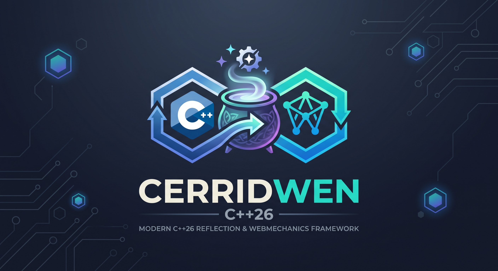

# Cerridwen

<p align="center">
  
</p>

Cerridwen is a modern, high-performance C++26 framework designed to securely expose C++ classes to WebAssembly (WASM) and allow WebAssembly plugins to be loaded seamlessly within native applications. By leveraging C++26 reflection (`std::meta`), Cerridwen automatically generates bindings, trampolines, and proxy classes without requiring external AST parsers or boilerplate code.

## The Mythos

In Celtic mythology, **Cerridwen** is a powerful enchantress and the keeper of the cauldron of knowledge, inspiration, and transformation (the *Awen*). The potion brewed within her cauldron grants profound wisdom and the ability to shape-shift into any form.

We chose this name because the framework acts as a modern cauldron of transformation for C++ applications. By brewing C++ code with WebAssembly, Cerridwen transforms static, monolithic host applications into dynamic, extensible platforms. It securely confines untrusted WebAssembly plugins while granting them the "wisdom" to interoperate seamlessly with complex C++ class hierarchies, shifting shapes across the WebAssembly/Native boundary.

## Key Features

* **C++26 Reflection (`std::meta`)**: Automatically analyzes C++ class structures at compile time to generate bridging code for WebAssembly, eliminating the need for SWIG, libclang scripts, or manual binding layers.
* **Full Inheritance Support**: Natively supports Single Inheritance, Multiple Inheritance, and Virtual Inheritance across the WebAssembly boundary. The framework automatically adjusts `this` pointers when dispatching calls from WASM plugins back to host C++ objects.
* **Virtual Method Overrides (Trampolines)**: WebAssembly plugins can subclass C++ classes and override virtual methods. When the C++ host calls a virtual method, Cerridwen's generated trampolines dynamically route execution into the WASM sandbox and marshal return values back.
* **Proxy-Based Data Marshalling**: Complex C++ data members (strings, vectors, custom structs) are safely marshaled between host and plugins using Reference Proxies and memory offset mapping, ensuring minimal allocations and robust memory bounds checking.
* **Rich Container Serialization**: High-performance binary buffer serialization supporting `std::vector`, `std::list`, `std::deque`, `std::set`, `std::unordered_set`, `std::map`, `std::unordered_map`, `std::variant`, and `std::string` with bounds checking and overflow/underflow protection.
* **Smart Pointer Integration**: Robustly supports passing `std::shared_ptr` across the Host-WASM boundary natively through CICO (Copy-in/Copy-out) reference mapping mechanisms.
* **Multi-Threading & Concurrency Gating**: Since WebAssembly instances are single-threaded by design, Cerridwen provides multi-threading models (`CERRIDWEN_THREAD_SAFE` / `[[=cerridwen::thread_safe{}]]`) to safely gate, lock, and serialize access when multiple native C++ threads invoke WebAssembly plugins concurrently.
* **Cross-Domain Atomics**: Provides `cerridwen::CrossDomainAtomic<T>` allowing lock-free atomic operations (`fetch_add`, `fetch_sub`, `exchange`, `compare_exchange_strong`) between concurrent C++ Host threads and the WASM plugin running in the sandbox via direct memory mapping and hardware atomic instructions.
* **Sandboxed Persistent Storage**: Quota-governed file storage subsystem (`StorageHost` / `PluginStorage`) that isolates plugins into private disk sandboxes, restricts path traversal, and enforces byte quotas.
* **Resource Limits & Memory Protection**: Host-configured memory caps (`InstanceOptions.max_memory_bytes`), initial page bounds, and graceful interception of out-of-bounds memory accesses and WASM traps without crashing the host process.
* **Cross-Domain Exception Handling**: Strongly typed exception hierarchy (`CerridwenException`, `PluginException`, `ResourceLimitError`, `StorageError`, `SerializationError`) allowing plugins to raise errors via `CERRIDWEN_THROW` that cleanly propagate into native C++ `try`/`catch` blocks.
* **Unit Testing & Code Coverage**: Dedicated test runner scripts and automated code coverage reporting with terminal summaries and interactive HTML dashboards.

## ⚡ Quick Start

Cerridwen relies on C++26 structural annotations to guide the compile-time generation of WebAssembly bindings.

### 1. Defining Interfaces & Annotations

```cpp
#include <cerridwen/annotations.hpp>
#include <string>
#include <iostream>

// Export a C++ interface to WebAssembly
struct CERRIDWEN_EXPORT_WASM PluginInterface {
    virtual ~PluginInterface() = default;

    // A virtual method that the WebAssembly plugin will implement
    virtual void process_data(int input) = 0;
};

// Export a host interface so the plugin can call back into the host
struct CERRIDWEN_EXPORT_HOST LoggerHost {
    virtual ~LoggerHost() = default;
    virtual void log_message(const char* msg) {
        std::cout << "[Host] Plugin logged: " << msg << "\n";
    }
};
```

### 2. Host Application Loading the Plugin

```cpp
#include <cerridwen/wasm3_instance.hpp>
#include <cerridwen/storage.hpp>

int main() {
    // Configure execution options and memory limits
    cerridwen::InstanceOptions opts;
    opts.max_memory_bytes = 16 * 1024 * 1024; // 16 MB limit
    
    // Load the WebAssembly module securely
    auto instance = std::make_unique<cerridwen::Wasm3Instance>("my_plugin.wasm", opts);
    
    // Optional: attach a quota-governed sandboxed storage directory for the plugin
    cerridwen::StorageHost storage("./plugin_data", 1024 * 1024); // 1 MB quota
    instance->set_storage(&storage);
    
    // Bind host classes so the plugin can invoke them
    bind_LoggerHost(instance->get_module()); // Generated binding
    
    // Instantiate the exported C++ class implementation from the plugin
    uint32_t ptr = instance->call_create("PluginInterface_create");
    
    // Use the generated Trampoline class to interface with the WASM object
    PluginInterface_Trampoline plugin;
    plugin._wasm_instance = instance.get();
    plugin._wasm_ptr = ptr;
    
    // Call the virtual method. Execution securely drops into the WebAssembly sandbox!
    plugin.process_data(42); 
    
    return 0;
}
```

### 3. Writing the WebAssembly Plugin

```cpp
#include <cerridwen/plugin_api.hpp>

class MyPlugin : public PluginInterface {
public:
    void process_data(int input) override {
        if (input < 0) {
            CERRIDWEN_THROW("Invalid negative input!");
        }
        // Access sandboxed persistent storage
        cerridwen::plugin::Storage storage;
        storage.write("last_input.txt", &input, sizeof(input));
    }
};
```

## Advanced Data Marshalling & Annotations

Cerridwen provides structural annotations to control data transfer and threading models:

* `CERRIDWEN_MARSHAL_BY_VALUE`: Copies data directly into WASM linear memory. Suitable for primitives and trivially copyable structs.
* `CERRIDWEN_MARSHAL_BY_REF`: Creates a safe proxy handle inside the WASM module. When WASM accesses the field, it queries host memory with bounds verification.
* `CERRIDWEN_THREAD_SAFE`: Automatically generates mutex guards around trampoline invocations to serialize concurrent host calls into the single-threaded WASM runtime.
* `CERRIDWEN_STORAGE_CLASS`: Identifies persistent storage bridge structures.

## Building the Framework

Cerridwen utilizes CMake and requires GCC 16 (for `-std=c++26 -freflection`).

### Build

```bash
# macOS / Linux
./build.sh

# Windows (MSYS2 / MinGW)
.\build.bat
```

### Running Unit Tests

Cerridwen includes dedicated test runner scripts:

```bash
# Run standalone unit tests (fast C++ tests, ~40ms)
./run_unit_tests.sh

# Run full test suite (unit + reflection trampoline + WASM e2e)
./run_unit_tests.sh --all

# Filter specific tests by GoogleTest pattern
./run_unit_tests.sh --filter="*Storage*"
./run_unit_tests.sh --filter="*Serializer*"

# Enable verbose test output
./run_unit_tests.sh -v

# Perform clean rebuild before running tests
./run_unit_tests.sh --clean
```

### Code Coverage Analysis

Generate line, branch, and function code coverage metrics with summary tables and an interactive HTML report:

```bash
# Run coverage analysis (uses gcovr or lcov)
./run_coverage.sh

# Set custom coverage threshold percentage
./run_coverage.sh --threshold 70

# Open generated HTML report in the browser
./run_coverage.sh --open
```

The HTML report is saved to `build/coverage_report/index.html`.

### Docker (Cross-Platform Linux Builds)

To build and test within a Linux Docker container:

```bash
./scripts/run_linux_tests_docker.sh
```

## Requirements

* **Host Compiler**: GCC 16.1.0+ (requires `-freflection` flag for P2996 C++26 reflection support).
* **Language Standard**: C++26 (`-std=c++26`).
* **WebAssembly Runtime**: Wasm3 (automatically fetched and built via CMake FetchContent).
* **WASM Compiler**: Emscripten (`em++`) for compiling C++ plugins to WebAssembly.
* **Coverage Tools (Optional)**: `gcovr` or `lcov`/`genhtml` for generating code coverage reports.
* **Build System**: CMake 3.20+.

## License

Cerridwen is licensed under the GNU Affero General Public License v3.0.
